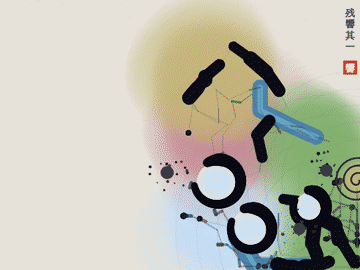
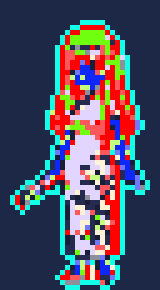

# 彩還し（いろがえし）

墨に色を奪われた世界を、扇の風で塗り返していく、ドット絵の見下ろし型サバイバーです。
**画像1枚がそのまま1ステージになる**のが特徴で、手持ちの画像を読み込んでも遊べます。
キャラクターも同じで、**画像を1枚渡せばそのまま主人公として遊べます**（背景は自動で抜きます）。

主人公は藍（アイ）。紺のチャイナドレスに扇を持った少女です。

## 遊び方

`index.html` をブラウザで開くだけで遊べます（ビルド済み・1ファイル完結）。

- 移動：WASD／矢印キー。スマホは画面をドラッグ（その場に仮想スティックが出ます）
- 攻撃：自動。扇から三日月形の風を扇状に放ちます
- 一時停止：P／Esc

### ルール

- ステージ画像は最初、色を失った灰色の状態です
- 墨（敵）を倒すと、その周りの色が戻ります。**色の戻った場所には墨が湧きません**
- 復元率 15・30・45% と、墨が濃くなったとき・大墨が現れたときに強化を3択で選べます
- ボス「大墨」は**墨が煮詰まると**生まれます（下の「墨の濃さ」）。名所めぐり・墨溜まり封じでは、型の目的を果たしたときにも現れます。倒すと画像の色がすべて戻ってクリアです
- 60% を超えたら「撤収する」で切り上げられます（記録はそのまま）。倒れると記録は半分になります
- **境界で祓う**：色のある場所と灰色の境目で墨を祓うと、色の戻る範囲が1マス広がります（金色の輪）

### 墨の濃さ

- 絵に染みこんだ墨の量は決まっています。**色を還しても墨は消えず、残りの灰色に押しこまれて濃くなります**（濃さ＝残りの墨 ÷ 灰色の広さ。始めは1倍）
- 墨を減らせるのは**祓うこと**だけです。灰色の中か境目で墨を倒す、筆の囲いで捕まえる、墨溜まりを封じる、名所を還す、のどれかです。色の奥深くで倒した墨は、灰色へ染みもどるので減りません
- **濃墨（1.5倍から）**：灰色が黒ずみ、右上の表示が「濃墨」になります。
  - 色の上で墨を倒したときの波及が、遠くの灰色まで届かなくなります（倒した場所の近くだけ）
  - 筆で囲んでも1回目は**墨を薄めるだけ**で、もう一度囲むと色が戻ります（薄めた所は明るい灰色になります）
  - 大きい墨が増えます
  - 濃墨のあいだは、時間がたつだけでも少しずつ煮詰まっていきます
- **煮詰まり（2.5倍）**：墨が集まって大墨が生まれます。そのとき残っている墨が多いほど強い大墨になり（0.75〜1.4倍）、「濃い大墨」「薄い大墨」と出ます。囲みで広げるのを急げば早く、祓いを重ねれば遅く弱い大墨になります
- 立っているだけ・色の上をうろつくだけでは、濃墨になった所（だいたい復元率35%）から先へ進めません

### 型（ステージのルール）

同じ絵でも、選ぶ型で遊び方が変わります。タイトルでステージを選ぶと型のボタンが出て、その絵に合う型に「おすすめ」が付きます。自己ベストは型ごとに残ります。

| 型 | 目的 | 大墨が現れる条件 | 序 → 破 → 急 |
|---|---|---|---|
| 全面復元 | 絵のすべてに色を還す | 墨が煮詰まる（遅くとも復元率 90%） | 濃墨になると破（灰色の中で祓う）→ 大墨で急 |
| 名所めぐり | 絵の名所を3つ還す（順番は自由） | 名所3つ、または墨が煮詰まる（残した名所1つにつき大墨が15%強い。遅くとも復元率 95%） | 名所を1つ還すと破（墨溜まりが騒ぎだし、色を食べる速さが上がる）→ 大墨で急 |
| 墨溜まり封じ | 目覚めていく5つの墨溜まりをすべて封じる | 全部を封じる、または墨が煮詰まる（残した墨溜まり1つにつき大墨が15%強い。遅くとも復元率 92%） | 1つ封じるか60秒で破（2つ目覚める）→ 起きている分を封じるか150秒で急（残りが目覚め、最後の1つは大墨溜まり） |
| 潮の満ち引き | 暗い低地から満ちる墨の潮をしのぐ | 墨が煮詰まる（遅くとも復元率 90%） | 30% で破（潮が高くなる）→ 大墨で急（大潮） |

- **序・破・急**：どの型も3幕で進みます。幕が変わると表示が出て、墨の湧く速さも上がります（序 0.9倍・破 1.1倍・急 1.2倍）。画面上部の左に今の幕と目的が出ます
- **名所**：絵の中で同じ色がまとまった大きな区画が名所になります（色の名前で「藍の名所」など）。点線の枠と金色の印で示され、85% を還すと残りが一気に色づき、体力が1回復し、近くの墨が祓われます。画面外の名所は金色の矢印が指します
- **潮**：明るさを高さとみなし、暗い（低い）灰色の土地から順に墨の潮が満ちます。約16秒ごとに3秒かけて満ち、7秒続きます。潮の中は歩くのが遅くなり、2.5秒ごとに傷を受けます。墨は潮の中で速くなり、満潮のときは潮から湧きます。**色を還した場所には潮が来ない**ので、低地を先に還すと堤になります

### 連作（一戦が次の絵になる）



遊び終えると（クリア・撤収・倒れた、どれでも）、その一戦が**一枚の絵**になり、結果画面に掛け軸として出ます。その絵は**そのまま次のステージ**として遊べ、遊び終えるとまた次の絵が生まれます。5枚つづくと連作が完成します。

- 絵は流派「残響」が描きます（考え方は [docs/ryuha_zankyo.md](docs/ryuha_zankyo.md)）。一戦の記録から次のように決まり、同じ一戦からは何度描いても同じ絵になります

  | 一戦の記録 | 絵 | 次のステージ |
  |---|---|---|
  | 歩いた道 | 速いほど細い掠れ、立ち止まった所ほど深い墨 | 深い墨は通れない |
  | まっすぐ走り抜けた長い道 | 藍の水脈 | 水 |
  | その次に長いまっすぐな道 | 途切れのある太い筆の一画 | 闇の壁（途切れから通れる） |
  | 筆で囲んだ大きな輪（最大3つ） | 開きのある円相と、内側の淡い色 | 名所（入口は円相の開き）。型は名所めぐりがおすすめになる |
  | 墨を多く祓った場所 | 墨はね | 墨溜まり |
  | 傷を負った場所 | 朱の点 | 朱（還すと回復） |
  | 大墨が崩れた場所 | 渦と波紋 | ― |
  | 一戦が終わった場所 | ― | 次の開始位置 |
  | よく還した色の系統 | にじみの色 | 育ちやすい色の力 |

- 描いた絵が閉じすぎている（歩ける所が52%未満、闇が30%超）ときは、筆を軽くして描き直します
- タイトルの「画帖」に連作ごとに並びます（最新24枚まで、このブラウザに保存）。絵を選ぶとステージ一覧の「画帖の絵」に入り、そのまま遊べます。記録は絵ごとに残ります
- 結果画面の「画像を保存」で、掛け軸に仕立てた PNG を保存できます

### 筆で囲む

- 色のある場所から灰色へ踏み出すと、通った跡に**筆の線**が引かれます。色の上に戻ると線が閉じ、**線で囲った灰色がまとめて色づきます**。中にいた墨は祓われます
- 小さい墨は線を越えられず、線に沿って滑ります。墨を囲いに閉じ込めてから閉じれば一網打尽です
- 大きい墨とボスは線を踏むと切ってしまいます。被弾しても切れます。切れたら色の上に戻ってやり直しです
- 一筆の長さには上限があり（40マス）、超えると筆が乾いて線が消えます。足元の金色の弧が残りの墨です
- 一度に囲める広さは260マスまでです。広すぎると「広すぎて囲めない」と出ます
- **囲いは自分で作る**：塗れるのは、まわりの85%以上が自分の線か色で囲まれた場所だけです。壁や絵の端に頼った囲い（袋小路の入口に線を引くだけ、端との間を区切るだけ）は「囲いが開いている」と出て塗れません
- **濃墨では2回囲む**：墨が濃墨になっているあいだは、1回目の囲みで墨が薄まり（「墨を薄めた」）、同じ所をもう一度囲むと色が戻ります
- **墨溜まりは一度では封じられない**：墨溜まりを囲むと体力が34%減ります（3回囲むか、風の刃と合わせて封じます）。生きている墨溜まりのまわり2マスは、囲んでも灰色のまま残ります

### 墨溜まり

- 絵の暗い（低い）場所に3つの**墨溜まり**があります。墨を生み出し、まわり8マスの色を少しずつ食べて灰色に戻します
- 風の刃で削る（体力40）か、筆で囲んで削ると封じられます（囲み1回で体力の34%）。近くに立つと、扇の風が2回に1回は墨溜まりを狙います。封じると周囲に色が戻り、近くの墨も祓われます
- 画面の外にある墨溜まりは、画面の端の矢印が指します。残りは画面上部の「墨溜まり ●●●」で分かります

### 色の力

取り戻した色の種類ごとに力が育ちます（30・90・200・380・640マスで Lv1〜5）。絵に多い色ほど強く育つので、絵ごとに戦い方が変わります。タイトルの「育つ力」で、その絵で育ちやすい色が分かります。

| 色 | 力 |
|---|---|
| 朱 | 風の刃が墨を燃やす（毎秒 0.5×Lv のダメージ） |
| 金 | 会心（6%×Lv の確率で威力2倍） |
| 緑 | 蔦が近くの墨を縛って止める |
| 藍 | 風の刃が墨を遅くする（最大5割） |
| 紫 | 体のまわりの墨を毒で削る |
| 白 | 紙の盾が被弾を1回防ぐ（しばらくすると戻る） |

一時停止すると、いまの色の力と次の段階までのマス数が見られます。
- **香料と工房**：遊び終わるたびに香料がもらえます（復元率1%につき1、クリアで+30。倒れたときは半分）。タイトルの「工房」で道具を手入れすると、次から少しだけ強くなります

### 工房（強化は控えめ）

| 道具 | 効果（1段ごと） | 上限 | 費用 |
|---|---|---|---|
| 扇の手入れ | 風を放つ間隔 −3% | 5段（−14%） | 30 → 45 → 68 → 101 → 152 |
| 草履の鼻緒 | 歩く速さ +2% | 5段（+10%） | 同上 |
| 筆おろし | 一筆で引ける線 +4マス | 5段（+20マス） | 同上 |
| 硯の墨 | 色づいた場所で墨を祓ったときの追い塗り +2% | 5段 | 40 から |
| 灯のお守り | 最大体力 +1 | 2段 | 90 → 135 |
| 丈夫な風呂敷 | 倒れたときに持ち帰る香料 50% → +10% | 3段（80%） | 30 から |

遊んでいる最中の強化（1回で +15〜20%）より一段小さくしてあり、全部そろえても強化1〜2回分ほどです。

### 地形（画像の色から自動判定）

| 地形 | 判定 | 効果 |
|---|---|---|
| 床 | 下記以外 | 普通に歩ける |
| 水 | 青〜水色 | 歩くと遅くなる。墨は水に溶けてダメージを受ける |
| 朱 | 赤〜朱色 | 色を戻すと、上に立っている間 HP が回復する |
| 闇 | とても暗い色 | 通れない |

## ステージ

| ステージ | 内容 | おすすめの型 |
|---|---|---|
| 月夜の水庭 | コードで描いた池と朱の橋の庭 | 全面復元 |
| 朱の楼閣街 | 運河と灯籠の夜の街 | 墨溜まり封じ |
| 竹林の小径 | 小川と紅葉・鳥居のある竹林。石畳の道が潮の来ない高台（ギミック指定の画像で指定） | 潮の満ち引き |
| 衣装棚 | キャラクター一覧の画像そのもの。3人の人物が名所（ギミック指定の画像で指定） | 名所めぐり |
| 画像からつくる | 手持ちの画像を読み込む | 絵から自動で選ぶ |

### ステージを増やす

`stages/` に画像を置いて `python3 build.py` を実行するだけです。名前・説明・並び順・おすすめの型は `stages/stages.json` で決められます（書かなければファイル名がそのまま名前になり、型は絵から自動で選ばれます）。

```json
{ "id": "bamboo_path", "name": "竹林の小径", "desc": "小川と紅葉の竹林", "template": "shio", "file": "bamboo_path.png" }
```

`template` は `full`（全面復元）・`meisho`（名所めぐり）・`fuuin`（墨溜まり封じ）・`shio`（潮の満ち引き）のどれかです。

型の自動選択は、明るさのばらつきが大きい絵（標準偏差 0.15 以上）は潮、はっきりした色の区画が3つ以上ある絵は名所、それ以外は墨溜まり封じです。

### ギミック指定の画像（マスク）

墨溜まり・名所・高台などを手で置きたいときは、ステージ画像と同じ形の画像を `ステージ名_mask.png` という名前で `stages/` に置きます（`stages.json` の `"mask"` で別の名前も指定できます）。背景は透明にして、次の純色で塗ります。

| 色 | 意味 |
|---|---|
| 赤 (255,0,0) | 墨溜まり（ひとかたまりで1つ） |
| 黄 (255,255,0) | 名所（ひとかたまりで1つ） |
| 青 (0,0,255) | 低い土地（潮が最初に満ちる） |
| 白 (255,255,255) | 高い土地（潮が来ない） |
| 緑 (0,255,0) | スタート位置 |

数ピクセル塗るだけで、そのマスに効きます。ぼかしやアンチエイリアスは切ってください。たたき台は自動で作れます。

```bash
python3 tools/make_mask.py stages/竹林.png    # → stages/竹林_mask.png（名所・墨溜まり・スタートの候補を塗ったもの）
```

できた画像をペイントソフトで直して `python3 build.py` を実行すれば反映されます。見本は `stages/bamboo_path_mask.png`（道を白で高台に）と `stages/wardrobe_mask.png`（人物3人を黄で名所に）です。

### 画像 → ステージの変換

1. 長辺 128px に縮小し、24色に減色（ドット絵化）
2. 2×2 ピクセルを1マスとして、平均色の明るさ・色相・彩度から地形を判定
3. 壁が 35% を超えないように暗さのしきい値を自動調整
4. 塗りつぶしでつながっている最大の領域だけを遊べる範囲にする（閉じ込めを防ぐ）

どんな画像（極端に小さい・暗い・透過あり）でも遊べるステージになるようにしています。

## キャラクター

タイトルの「キャラクター」で選びます。「画像から」を押すと、手持ちの画像でその場で遊べます。

### キャラクターを増やす

`characters/` に画像を置いて `python3 build.py` を実行するだけです。

- `characters/名前.png`（画像1枚）または `characters/名前/` フォルダ（中の `sprite.*`、なければ最初の画像）
- 背景が透明でない画像（JPEG・白背景など）は、外周の色を自動で抜いて切り抜きます
- 1枚絵の場合、歩くと弾む・揺れる、止まると呼吸する、扇を振ると前に傾く、という動きをゲームが自動で付けます
- 高解像度の絵はそのままの細かさで描きます（ズームに合わせて縮小しておき、画面の画素と1対1で描画）。ドット絵は四角い画素のまま拡大します
- 見た目の高さは 54（ゲーム内の単位）にそろえ、当たり判定も高さに合わせて決まります

### 動きを Pixelorama で描く

藍の動きは Pixelorama のプロジェクト `characters/aoi/aoi.pxo` が元になっています。**Pixelorama で開いて描き直し、保存して `python3 build.py` を実行すると、そのままゲームに入ります**（PNG への書き出しは要りません）。



| タグ | コマ | ゲームで使う場面 |
|---|---|---|
| `idle` | 4 | 立ち止まっているあいだ（くり返し） |
| `walk` | 4 | 歩いているあいだ。0番が立ち姿で、`loop` の順にくり返す |
| `attack` | 4 | 扇を振るたび（溜め → 振り → 振り切り → 戻り） |
| `hurt` | 2 | 墨に当たった直後（のけぞり） |
| `win` | 4 | 大墨を祓ったあと（しゃがむ → 跳ねて扇を掲げる → きらめき → 着地） |

- 動きの区切りは Pixelorama の**アニメーションタグ**で決まります。タグ名を上の名前のままにしておけば、コマを増やしても減らしてもかまいません。`walk` 以外のタグはなくても動きます
- コマの長さは、Pixelorama のフレームの長さ（フレームのプロパティ）とFPSから決まります
- キャンバスは 32×58 です。足元は下辺の中央（`feet: [18, 58]`）にそろえてください。上の4マスと左右2マスは、跳ねる・扇を掲げる・きらめきのための余白です
- レイヤーは何枚でもかまいません。表示しているピクセルレイヤーを重ねたものが使われます（Pixelorama 1.0 以降の .pxo を読めます）
- 最初の下書きは `python3 tools/make_aoi_pxo.py` で元の立ち絵から作っています（実行すると aoi.pxo を作り直すので、手で直したあとは実行しないでください）

### character.json

コマ絵や Pixelorama のプロジェクトがある場合は `characters/名前/character.json` で指定します（`characters/aoi/character.json` が見本です）。

| 項目 | 意味 |
|---|---|
| `name` / `desc` / `alt` | 表示名・説明・代替テキスト |
| `order` | 並び順（小さいほど前） |
| `sprite` | 立ち絵（1枚絵として使う画像） |
| `portrait` | タイトルに大きく出す絵（省略すると立ち絵） |
| `pxo` | Pixelorama のプロジェクト（例 `"aoi.pxo"`）。タグ `idle` `walk` `attack` `hurt` `win` がそれぞれの動きになる |
| `walk` など | `pxo` を使うとき：`{ "tag": "walk", "loop": [1,2,3,2] }`（タグ名が違うときだけ `tag`）。PNG のコマ絵を使うとき：`{ "file": "walk.png", "frames": 4, "loop": [1,2,3,2], "dt": 0.15 }` 横に並べたコマ。0番が立ち姿。`attack` も同じ形 |
| `feet` | コマの中の足元の位置 `[x, y]`（画素） |
| `body` | キャンバスの上に余白があるときの、体の高さ（画素）。当たり判定はこの高さで決まる |
| `height` | 見た目の高さ（36〜80、標準 54） |
| `pixelated` | `true` でドット絵扱い（省略すると大きさから自動判定） |
| `faces` | 元の絵が向いている向き `"left"` / `"right"` |

## ファイル構成

```
index.html            ビルド済みのゲーム（これだけで動く）
game.src.html         ゲームのソース（画像はプレースホルダー）
build.py              stages/・characters/ の画像と効果音を埋め込んで index.html を作る
parts/sfx.js          効果音（WebAudio で合成。音声ファイルなし）
characters/           キャラクター（aoi/ に藍の立ち絵・動きの Pixelorama プロジェクト aoi.pxo・character.json）
stages/               ステージ画像と stages.json、ギミック指定の画像（*_mask.png）、生成スクリプト・地形チェック
tools/                キャラ切り抜き・動きの下書き（aoi.pxo）作り・マスクのたたき台作りのスクリプト
docs/                 設計メモ（流派「残響」の宣言、次の型「摺り」のプロット）
```

## ビルド

```bash
python3 build.py
```

`game.src.html` を編集したとき、`stages/` や `characters/` に画像を足したときに実行してください。`index.html` が更新されます。

### 素材を作り直す

```bash
# 一覧画像からキャラを切り抜いてスプライト化
python3 tools/cut_character.py 一覧画像.jpg --box 118 20 196 130

# 藍の動きの下書き（待機・歩き・扇・被弾・勝ち）を Pixelorama のプロジェクトとして作る
# （aoi.pxo を上書きするので、Pixelorama で手を入れたあとは実行しない）
python3 tools/make_aoi_pxo.py

# 追加ステージ画像を生成し、地形の比率をチェック
python3 stages/gen_shu_street.py
python3 stages/gen_bamboo_path.py
python3 stages/check.py --all
```

## 技術メモ

- Canvas 2D と素の JavaScript だけで動作（ライブラリなし）
- 外部通信は Google Fonts のみ。自己ベストは localStorage に保存
- 調整用の数値はソース内の `TUNE`・`ENEMY`・`BRUSH`（筆で囲む）・`SPRING`（墨溜まり）・`HUE`（色の力）・`TPL` と `TEMPLATES`（型）・`SHOP`（工房）にまとめています
- 自己ベスト・香料・工房の段階・選んだキャラクターは localStorage に保存します

### デバッグ画面

URL の末尾に `#debug` を付けるか、タイトルの「彩還し」の文字を2秒以内に5回タップ（クリック）すると、右下に「DEBUG」ボタンが出ます。タップで開いた場合は次に開いたときも出たままになり、パネルの「デバッグをやめる」で消せます。

- **筆で囲む・墨溜まり・墨の濃さ・進行・色の力・型**：一筆の長さ、囲める広さ、囲いのうち線と色で作る割合、囲んだ墨溜まりを削る割合、墨溜まりの数・体力・食べる速さ、1体祓うと減る墨、濃墨・煮詰まりになる濃さ、濃墨が煮詰まっていく速さ、濃墨に波及が届く距離、濃墨で増える大きい墨、大墨の強さの基準、大墨が必ず出る復元率、境界の広がり、色の力に必要なマス数、名所の数と還る割合、封じの墨溜まりの数、潮の長さと傷の間隔をその場で変えられます（すぐ反映され、このブラウザに保存されます）。「値をコピー」で `BRUSH` `SPRING` `HUE` `TPL` `INK` の行が手に入るので、ソースに貼れば初期値になります
- **テスト**：無敵、工房の強化を切る、復元率 +10%、ボスを出す、香料 +100、工房のリセット
- **ペース計測**：選んでいるステージと型で、ボットが3回遊び、ボスが出るまでの時間、クリア時間、筆で囲んで戻した割合、墨溜まりの封印数、食べられた色の割合、濃墨になった復元率、大墨が出た復元率と強さを表示します（「歩き続ける操作」と、小さな輪を描いて囲む「線で囲む操作」）。工房の強化は切って測り、記録や香料には影響しません
- テスト用の `window.__dbg` も有効になります
